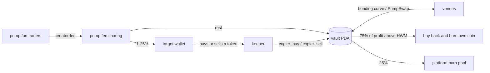

# copy-trade-vault-program

A Solana program (Anchor 0.31) for vaults that copy one public wallet's trades on pump.fun and PumpSwap. The
off-chain keeper only decides when to submit a copy. The program decides whether it is allowed: it re-reads the
target's token balance on-chain, caps the size by the target's own trade, and measures every fill from balance
deltas. Realized profit above a high-water mark is split between buybacks of the vault's coin and a platform burn
pool. There is no withdraw instruction.

Program id: `9R8g8JtEqRAh5yZ4aXbf1mWcfgLq9kAo6fmx93MSK9k7` (not deployed to any public cluster).

## How it works

Each copier is a pump.fun coin tied to a target wallet. The coin's creator fees are split with pump's own fee-sharing
program between the target (1% to 25%, chosen at launch) and a vault PDA. The launch transaction revokes the
fee-sharing admin, and `register_copier` refuses to register a coin unless that split is final.



What the program checks on every copy:

- `copier_buy` only runs if the target's token balance went up since the last snapshot stored on-chain, and the
  vault's spend is capped by the value of the target's buy (`signal_multiple_bps`).
- Per-trade, per-position and price-impact caps, a rolling spend window (default 30% of equity per hour), a minimum
  vault balance and a maximum number of open positions.
- The vault only signs venue instructions on a timelocked whitelist of (program, discriminator) descriptors. A trade
  must be a top-level instruction and the only venue interaction in its transaction (`guard.rs`), which rules out
  in-transaction sandwiches and CPI wrappers.
- `copier_sell` follows the target's sell proportionally. After `max_hold_secs` anyone can exit a position, and if
  the keeper's heartbeat is older than its grace period, anyone can exit positions the target no longer holds.
- Lamports that reach the vault without going through the program (creator fees, donations) are booked as fee
  income by `sync`. Profit is measured against a high-water mark, so losses are won back before anything is burned.
- Config changes (keeper, parameters, venue whitelist, index targets, admin) are proposed and executed only after a
  timelock fixed at `initialize_config` (60 seconds to 7 days). `pause_keeper` is immediate.

An index copier (`register_index`, admin only) follows up to 16 wallets and keeps 100% of its creator fees. One
index copier can be marked as the platform token with `set_platform_mint`; `burn_platform` spends the burn pool on
it.

[`docs/PROGRAM.md`](docs/PROGRAM.md) covers accounts, accounting, invariants, the trust model and compute units.
[`docs/SPEC.md`](docs/SPEC.md) is the contract between the program, SDK, keeper and indexer.
[`docs/research/`](docs/research) has the pump.fun interface notes the program is built against.

## Layout

| Path | Contents |
|---|---|
| `programs/copy-vault` | The Anchor program: config and timelocked governance, `register_copier` / `register_index`, `deposit`, `sync`, `verify_trader`, `copier_buy` / `copier_sell` (descriptor-whitelisted pass-through CPI), `buyback_burn`, `fund_platform_burn`, `burn_platform` |
| `tests/program` | 38 LiteSVM tests that load mainnet dumps of pump, PumpSwap, pump fees, mayhem, SPL Token, Token-2022 and the ATA program from `fixtures/` (`dump-fixtures.sh` refreshes them), plus a small CPI wrapper program used to prove trades refuse to run as a CPI |
| `packages/sdk` | `@copy-trade-vault/sdk`: PDAs, account decoders, bigint curve and pool math, launch / trade / crank instruction builders, venue resolver, event parser, API types |
| `apps/watcher` | The keeper: websocket detection of target transactions (optional Yellowstone gRPC), a signer and balance-delta classifier, sizing policy, simulate then send (optional Jito bundle), fee and burn cranks, `/status` endpoint ([README](apps/watcher/README.md)) |
| `apps/indexer` | Event indexer with a REST and WebSocket API on fastify and `node:sqlite`: copiers, positions marked to market, copies with lag, fees, burns, a wallet directory ([API.md](apps/indexer/API.md)) |
| `scripts` | Localnet validator with cloned mainnet pump programs, config setup, seeding, a trading simulation, admin and ops-check CLIs, `deploy.sh` |

## Getting started

Requirements: Node 24, pnpm 10, a stable Rust toolchain, the Solana CLI (Agave 3.1) and anchor-cli 0.31.0. The
program build and the localnet scripts need Linux, macOS or WSL.

TypeScript packages:

```bash
pnpm install
pnpm typecheck
pnpm test          # SDK 47, keeper 57, indexer 94 tests
```

Program:

```bash
anchor build                          # target/deploy/copy_vault.so, target/idl/copy_vault.json
cargo test -p copy-vault-tests        # 38 LiteSVM tests against the committed mainnet fixtures
pnpm --filter @copy-trade-vault/sdk sync-idl   # copy a rebuilt IDL into the SDK
```

`anchor build` creates a throwaway program keypair in `target/deploy/` if none exists. The tests and the local
validator load the program at the id in `declare_id!`, so neither needs the matching keypair. To deploy to devnet
or mainnet, generate your own keypair at `.secrets/copy_vault-keypair.json` (gitignored), then put its public key
in `declare_id!`, `Anchor.toml`, `COPIER_PROGRAM_ID` in `packages/sdk/src/constants.ts` and `EXPECTED_PROGRAM_ID`
in `scripts/deploy.sh`.

Local network (needs `solana-test-validator` and access to a mainnet RPC to clone the pump programs):

```bash
pnpm localnet            # validator with cloned pump programs, deploys copy_vault.so
pnpm setup:localnet      # config, keeper, platform address lookup table
pnpm seed:localnet       # test wallets, six copiers, an index copier, trades, a fee distribution
pnpm dev                 # indexer on :8790, keeper status on :8792
pnpm simulate:localnet   # keeps target and public trading going so copies, fees and burns happen
```

CI runs the TypeScript typecheck and tests, `anchor build`, and the program test suite on every push.

## Limits

- A target can trade against its own followers: buy, wait for the copy, sell into it. The signal cap, impact caps
  and public lag and PnL stats reduce this. Nothing in the program removes it, and wallets that hold for seconds
  are poor targets.
- Copies land after the target's transaction, usually a few slots later, so the vault pays a worse price.
- pump.fun changes its instructions often. New variants are enabled through the descriptor whitelist instead of a
  redeploy, but the whitelist change still waits for the timelock.
- A compromised keeper can spend at most `max_window_spend_bps` of a vault's equity per window before
  `pause_keeper`. The program's upgrade authority can replace the program, so it should sit behind a multisig with
  its own timelock, or be removed, before a vault holds real funds.

## License

MIT, see [LICENSE](LICENSE).
